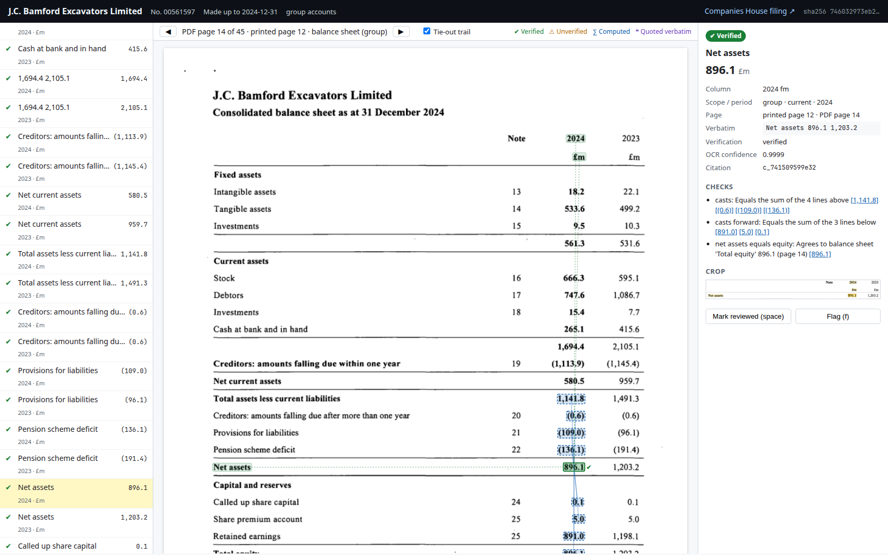

# ch_accounts_mcp: Companies House audited accounts over MCP

An MCP server that reads UK audited accounts filed at Companies House (FRS 102, FRS 101, IFRS, text-layer or scanned) and returns the primary statements, notes, audit report and narrative sections, with a citation on every figure and quote.

It is built for qualified accountants who need to trace any figure back to the filed document in seconds:

- **Figures are proved by arithmetic, not by OCR confidence.** Every value is cast within its column (subtotals, totals, balance sheet identities) and cross-checked between statements (net assets = equity, profit and total comprehensive income agree to the equity statement, cash agrees to the cash flow). A figure that cannot be proved is returned as `unverified`, with its page, box and a crop image. It is never presented as fact.
- **The server makes citations, the model does not.** A citation is built from stored OCR tokens and their coordinates in PDF points: label, value, column header and unit spans, page, printed page, checks passed, crop and a viewer deep link. The model refers to a citation by its id.
- **Answers are checked.** `check_answer` tags every number and quote in a draft answer as matched (with citation id), matched-but-unverified, or unmatched. `compute` does the arithmetic server-side, with each input cited.

The older CLI and Flask extractor in this repository (`main.py`, `web_app.py`, `src/`) is separate and unchanged.

## Contents

- [Setup](#setup)
- [Run under Claude Desktop (stdio)](#run-under-claude-desktop-stdio)
- [Run as a remote connector (streamable HTTP, bearer token)](#run-as-a-remote-connector-streamable-http-bearer-token)
- [Environment variables](#environment-variables)
- [Tools](#tools)
- [Highlight viewer](#highlight-viewer)
- [Accuracy and latency (measured)](#accuracy-and-latency-measured)
- [Sample `get_primary_statements` response](#sample-get_primary_statements-response)
- [Status against the brief](#status-against-the-brief)
- [Known gaps and next steps](#known-gaps-and-next-steps)
- [Layout of the code](#layout-of-the-code)

## Setup

Python 3.11 or later. From the repository root:

```bash
python3 -m venv .venv && . .venv/bin/activate
pip install -e ".[dev]"          # or: pip install -r requirements-mcp.txt
cp .env.example .env             # then put your key in .env; the file is gitignored
python -m pytest tests           # unit tests (no network, no OCR models needed)
```

A `.env` in the working directory is read at start-up. It uses the same names as the environment variables, it never overrides a variable that is already set, and its values are never logged or returned. The placeholder `your_api_key_here` is treated as unset.

Install in editable mode (`-e`) or run from the checkout, because the viewer's static files live in `viewer/` next to the package.

The CPU OCR path uses RapidOCR on ONNX Runtime; its models ship inside the `rapidocr-onnxruntime` wheel, so nothing is downloaded at start-up. For a GPU host, install `.[gpu]` plus the `paddlepaddle-gpu` wheel for your CUDA version and set `OCR_DEVICE=cuda` (the engine then defaults to PaddleOCR). The engine is chosen by `OCR_ENGINE`, and `ch_accounts_mcp/ocr.py` keeps both behind one interface (`make_engine`).

No Companies House API key is needed for `pdf_path` or `pdf_url` inputs, or for public filing-history lookups; set `COMPANIES_HOUSE_API_KEY` to use the official API (search, filing history and the document API) instead of the public pages.

## Run under Claude Desktop (stdio)

Add the server to `claude_desktop_config.json` (Claude Desktop, Settings, Developer, Edit Config):

```json
{
  "mcpServers": {
    "companies-house-accounts": {
      "command": "/path/to/repo/.venv/bin/python",
      "args": ["-m", "ch_accounts_mcp.server"],
      "cwd": "/path/to/repo",
      "env": {
        "COMPANIES_HOUSE_API_KEY": "optional-your-key",
        "CACHE_DIR": "/path/to/cache",
        "OCR_WORKERS": "4"
      }
    }
  }
}
```

Under stdio the server also starts the highlight viewer on `http://127.0.0.1:8765` (set `START_VIEWER=0` to turn it off, `VIEWER_PORT` to move it), so citation `viewer_url`s open in a local browser. Viewer links are signed per document when `MCP_BEARER_TOKEN` is set.

To exercise the server end to end exactly as a client would:

```bash
python scripts/mcp_stdio_demo.py /path/to/accounts.pdf /tmp/demo_out
```

This launches the server over stdio, calls `load_accounts`, `get_primary_statements`, `get_citation`, `get_page_image`, `compute` and `check_answer`, and writes every response (JSON and PNG crops) to the output folder.

## Run as a remote connector (streamable HTTP, bearer token)

```bash
export MCP_BEARER_TOKEN="$(python -c 'import secrets; print(secrets.token_urlsafe(32))')"
export PUBLIC_BASE_URL="https://accounts.example.com"   # used in viewer and crop links
export MCP_ALLOWED_HOSTS="accounts.example.com"         # Host header allow-list (DNS rebinding protection)
ch-accounts-mcp --http --host 0.0.0.0 --port 8000       # or: python -m ch_accounts_mcp.server --http ...
```

- The MCP endpoint is `POST /mcp` (streamable HTTP). Every request must send `Authorization: Bearer <MCP_BEARER_TOKEN>`; anything else gets `401`.
- The server refuses to listen on a non-loopback address without `MCP_BEARER_TOKEN` (override with `--allow-no-auth` only behind your own auth proxy).
- The viewer, page tiles, crops and workpaper downloads are served from the same port. Their links carry an HMAC signature tied to the document hash and derived from the bearer token, so they open in a browser without exposing the token.
- Put TLS in front (a reverse proxy or the platform's load balancer).

Client configuration, for clients that let you set a header (for example Claude Code, Cursor, or the `mcp-remote` bridge for Claude Desktop):

```bash
claude mcp add --transport http companies-house-accounts https://accounts.example.com/mcp \
  --header "Authorization: Bearer $MCP_BEARER_TOKEN"
```

```json
{
  "mcpServers": {
    "companies-house-accounts": {
      "command": "npx",
      "args": ["-y", "mcp-remote", "https://accounts.example.com/mcp", "--header", "Authorization:${AUTH_HEADER}"],
      "env": { "AUTH_HEADER": "Bearer <MCP_BEARER_TOKEN>" }
    }
  }
}
```

Claude's web "custom connector" dialog expects OAuth rather than a static bearer token; OAuth is not implemented yet (see next steps).

## Environment variables

| Variable | Default | Purpose |
|---|---|---|
| `COMPANIES_HOUSE_API_KEY` | unset | Official Companies House API (search, filing history, document API). Without it, public pages are used. Never logged or returned. |
| `ANTHROPIC_API_KEY` | unset | Reserved for the optional vision second reader (brief 8.3 step 3); read but not used yet. Never logged or returned. |
| `MCP_BEARER_TOKEN` | unset | Required for HTTP on a non-loopback host. Also the key for signed viewer links. |
| `CACHE_DIR` | `~/.cache/ch_accounts_mcp` | Content-addressed store: original PDFs (byte-for-byte), page tokens, page maps, citations, crops, tiles, workpapers, extraction log, rate-limit bucket. |
| `OCR_DEVICE` | `cpu` | `cpu` or `cuda`. |
| `OCR_ENGINE` | `rapidocr` on CPU, `paddleocr` on CUDA | OCR engine. |
| `OCR_WORKERS` | CPU count | Size of the OCR process pool (one engine per process). |
| `PUBLIC_BASE_URL` | `http://127.0.0.1:<port>` | Base for `viewer_url`, `crop_url` and workpaper links. |
| `VIEWER_PORT` | `8765` | Viewer port under stdio. |
| `START_VIEWER` | `1` | Start the local viewer under stdio. |
| `MCP_ALLOWED_HOSTS` | unset | Comma-separated Host allow-list for HTTP. |
| `HOST`, `PORT` | `127.0.0.1`, `8000` | HTTP bind address (same as `--host`, `--port`). |
| `LOG_LEVEL` | `INFO` | Logs go to stderr; settings are logged with secrets shown only as `set` or `unset`. |

Companies House requests share one token bucket (600 requests per 5 minutes) across worker processes through the cache's SQLite database.

## Tools

Every response is JSON, includes `timings_ms` and `cache_hit`, and returns errors as `{"error": ...}` with any secret scrubbed.

| Tool | Inputs | Returns |
|---|---|---|
| `find_company` | `query` | Matches with number, name, status, incorporation date. |
| `list_accounts_filings` | `company_number` | Accounts filings with made-up date, type, transaction id, document link. |
| `load_accounts` | one of `company_number` + `year_end`, `transaction_id`, `pdf_path`, `pdf_url` | `doc_id` (SHA-256 of the PDF), page count, text layer or scanned, page map (kind, scope, ranges, printed pages), notes index, Companies House link, viewer link. |
| `get_primary_statements` | `doc_id`, optional `statements` (`income`, `balance`, `cash_flow`, `equity`), optional `scope` (`group`, `company`) | Per statement: markdown table (unverified values marked `(?)`), rows with a `citation_id`, `status` and `provenance` on every value, columns with year, period, scope and unit; verification summary, cross-checks, the list of unverified cells with page and box, and inline crops of up to 8 unverified figures. |
| `get_citation` | `citation_id` | Full citation object (section 15.4 of the brief) and a PNG crop of the row with its column header. |
| `get_page_image` | `doc_id`, `page`, optional `bbox` (PDF points), `dpi` | PNG of the page or region. |
| `get_note` | `doc_id`, `topic` (note number or words, for example `borrowings`, `leases`, `related party`) | Note text and tables verbatim with pages and citations; table columns are cast. |
| `get_audit_report` | `doc_id` | Firm, senior statutory auditor, opinion type, emphasis of matter, material uncertainty on going concern, key audit matters, each with a quote citation. |
| `get_section` | `doc_id`, `section` (`strategic_report`, `directors_report`, `accounting_policies`, `going_concern`, `post_balance_sheet_events`) | Verbatim paragraphs with pages and quote citations. |
| `search_document` | `doc_id`, `query`, `limit` | BM25-ranked paragraphs with pages and quote citations. |
| `compare_years` | `company_number`, `years` | Primary statement lines spread across cached filings, with prior-year agreement checks. |
| `check_answer` | `doc_id`, `draft_text` | Every number and quote in the draft tagged matched / matched-unverified / unmatched, plus the draft with inline tags. Handles unit conversion (`£4.8m` against `4,812 £'000`) and rounding. |
| `compute` | `doc_id`, `metric` (`net_assets`, `gross_margin`, `operating_margin`, `net_margin`, `current_ratio`, `net_debt`, `ebitda`, `interest_cover`, `gearing`, `revenue_growth`) or a custom `definition` over citation ids, optional `scope`, `year` | The result as a `computed` citation: formula with every input cited, the definition used, and a flag if any input is unverified. |
| `export_workpaper` | `doc_id`, `citation_ids` or `answer`, optional `reviewer` | Excel and PDF tick-and-reference workpaper (header with filing details and document hash, one row per figure with crop and checks, unverified items listed separately, sign-off block), with signed download links. |

Citation statuses: `verified`, `verified_rounding`, `verified_after_reread` (re-OCR at 300 DPI made it tie), `unverified`. `verified_by_second_reader` is reserved for the vision second reader. Provenance types: `extracted_verified`, `extracted_unverified`, `computed`, `quoted`, `judgement`.

## Highlight viewer

`/view/{doc_sha256}?c={citation_id}` opens the filing at the cited page with the value highlighted strongly and its label, column header and unit more lightly, joined by thin connectors. A banner shows company, number, made-up date, accounts type and the Companies House link. The side list groups every citation by statement with provenance filters; `n` / `p` move through citations, `space` marks one reviewed, `f` flags it, and a progress bar tracks review (stored in the browser). The tie-out trail (`t`, or `&trail=1`) highlights the figures a verified value casts with and the total it feeds. Page tiles are pre-rendered when a document is loaded.



## Accuracy and latency (measured)

`bench.py` runs the real MCP tools in-process over the hand-keyed gold set in `tests/gold/` (PDFs are fetched from Companies House and checked against pinned SHA-256s by `python -m tests.gold.fetch`):

```bash
python bench.py --repeats 2 --json bench_results.json
```

**Hardware: 4 vCPU Intel Xeon (cloud VM), 16 GB RAM, no GPU. OCR: RapidOCR (ONNX Runtime, CPU), 4 worker processes.** All four gold filings are image-only scans (no text layer).

| Gold filing | Framework | Pages | Gold figures | Precision (verified) | Recall (verified and correct) | Share unverified |
|---|---|---|---|---|---|---|
| J.C. Bamford Excavators Ltd, 2024 group | FRS 102 | 45 | 116 | 100% | 100% | 0.0% |
| Mott MacDonald Group Ltd, 2024 group | FRS 102 | 92 | 134 | 100% | 100% | 0.0% |
| Tesco Stores Ltd, 2025 | FRS 101 | 64 | 104 | 100% | 100% | 0.0% |
| Boots UK Ltd, 2024 | FRS 101 | 56 | 116 | 100% | 92.2% | 6.1% |
| **All** | | | **470** | **100% (461 / 461)** | **98.1%** | **1.5%** |

- No figure was returned as verified with a wrong value. Of the 9 gold figures not returned verified, 7 came back `unverified` with the correct value (Boots 2023 comparatives on a faint scan, where the column does not cast) and 2 were not read at all (Boots: one value under a double rule, one unlabelled subtotal).
- Trust tests on the same real filings: 15.12(1) 4,833 / 4,833 figure-citation spans equal the stored OCR tokens inside their box; 15.12(2) 913 / 913 labelled figure citations carry label, value, column header and unit.
- 470 figures across 4 filings is far too small to demonstrate the 99.99% precision target; it shows no errors in this sample, nothing more.

Latency, milliseconds, measured with 2 cold runs per filing (fresh cache each time; the OCR worker pool already running, its one-off start-up is about 1.1 s):

| Tool | n | p50 | p95 | max |
|---|---|---|---|---|
| `load_accounts` cold (triage of every page) | 8 | 10,534 | 15,870 | 16,046 |
| `get_primary_statements` cold | 8 | 8,470 | 11,562 | 11,563 |
| both, cold | 8 | 19,484 | 26,185 | 26,300 |
| `load_accounts` warm | 12 | 4 | 8 | 9 |
| `get_primary_statements` warm | 12 | 3 | 5 | 5 |

The under-5-second cold target in the brief is for one L4 or T4 GPU and has **not** been measured; on this 4-vCPU CPU host, cold `get_primary_statements` is 8 to 12 s. Warm calls meet the under-100 ms target.

## Sample `get_primary_statements` response

From `scripts/mcp_stdio_demo.py` over stdio on the Boots UK Limited 2024 accounts (scanned, 56 pages), cold cache: `load_accounts` 8.1 s, `get_primary_statements` 9.8 s, 172 of 179 figures verified. Trimmed to three balance sheet rows; note the `-` nil comparatives and the 2023 deferred tax liability returned as unverified because that column of the scan does not cast:

```json
{
  "doc_id": "1dc9200f8b8b67edc1241190482606dad520c2d70795c952e277435c289a260b",
  "company_name": "Boots UK Limited",
  "statements": [
    {
      "statement": "balance_sheet",
      "scope": "company",
      "pages": [26],
      "printed_pages": ["24"],
      "unit": "£m",
      "columns": [
        {"key": "2024", "year": 2024, "period": "current", "unit": "£m", "header": "2024 Emllion"},
        {"key": "2023", "year": 2023, "period": "prior", "unit": "£m", "header": "2023 Emillon"}
      ],
      "markdown": "#### Balance sheet (PDF page 26, printed page 24)\n\n| Line item | Note | 2024 | 2023 |\n|---|---|---|---|\n| Assels |  |  |  |\n| Non-current assets |  |  |  |\n| Intangible assels | 13 | 666 | 855 |\n…",
      "rows": [
        {"label": "Deferred tax assels", "note": "24", "page": 26, "y": 262.4, "values": {
          "2024": {"value": 119.0, "raw": "119", "status": "verified", "provenance": "extracted_verified", "citation_id": "c_420232656083"},
          "2023": {"value": 0.0, "raw": "-", "status": "verified", "provenance": "extracted_verified", "citation_id": "c_141f32a5fe05"}}},
        {"label": "Deferred tax lialtles", "note": "24", "page": 26, "y": 539.6, "values": {
          "2024": {"value": 0.0, "raw": "-", "status": "verified", "provenance": "extracted_verified", "citation_id": "c_fb248f6901ae"},
          "2023": {"value": -69.0, "raw": "(69)", "status": "unverified", "provenance": "extracted_unverified", "citation_id": "c_1df2cf1a27d7"}}},
        {"label": "Net assets", "note": null, "page": 26, "y": 567.7, "values": {
          "2024": {"value": 866.0, "raw": "866", "status": "verified", "provenance": "extracted_verified", "citation_id": "c_7f6f87bce0d5"},
          "2023": {"value": 1543.0, "raw": "1,543", "status": "verified", "provenance": "extracted_verified", "citation_id": "c_acb8f87eaf07"}}},
        "… 33 more rows"
      ],
      "verification": {"figures": 71, "verified": 65, "unverified": 6, "share_verified": 0.9155, "by_status": {"verified": 65, "unverified": 6}}
    },
    "… income statement and SOCI (PDF 24-25), statement of changes in equity (PDF 27)"
  ],
  "verification": {
    "summary": {"figures": 179, "verified": 172, "unverified": 7, "share_verified": 0.9609, "by_status": {"verified": 172, "unverified": 7}},
    "cross_checks": [
      {"rule": "net_assets_equals_equity", "citation_id": "c_7f6f87bce0d5", "detail": "Agrees to balance sheet 'Total equity' 866 (page 26)", "related": ["c_a98b4abaf0fe"]},
      "…"
    ],
    "unverified": [
      {"citation_id": "c_447863f76736", "statement": "income_statement", "scope": "company", "label": "Taxation", "column": "2023", "raw": "(13)",
       "pdf_page": 24, "printed_page": "22", "bbox": [505.08, 312.12, 522.0, 320.4],
       "crop_url": "http://127.0.0.1:8765/crop/1dc92…/c_447863f76736.png", "viewer_url": "http://127.0.0.1:8765/view/1dc92…?c=c_447863f76736"},
      "… 6 more"
    ]
  },
  "viewer_url_template": "http://127.0.0.1:8765/view/1dc9200f…?c={citation_id}",
  "timings_ms": {"ocr_200dpi": 5068.8, "ocr_200dpi_pages": 4, "layout": 169.2, "verify": 42.7, "reread_ocr_300dpi": 4183.4, "reread_pages": 3, "reread_verify": 145.9, "citations": 11.5},
  "cache_hit": false
}
```

Labels are returned exactly as OCR read them ("Deferred tax lialtles") because citations must match the stored tokens; the crop and viewer show the filed text. The matching `get_citation` for revenue:

```json
{
  "citation_id": "c_ff68578ac4ea", "pdf_page": 24, "printed_page": "22",
  "statement": "income_statement", "scope": "company", "label": "Revenue", "note": "5",
  "column": "2024", "column_header": "2024 Emillon", "value": 7313.0, "raw": "7,313",
  "verbatim": "Revenue 5 7,313 7,053", "unit": "£m", "year": 2024,
  "status": "extracted_verified", "verification_status": "verified",
  "checks": [{"rule": "casts_to", "detail": "Part of Gross profit 2,681", "passed": true, "citation_ids": ["c_c0cebcd6a41f"]}],
  "spans": [
    {"role": "label", "text": "Revenue", "bbox": [65.16, 180.72, 92.88, 185.76]},
    {"role": "note", "text": "5", "bbox": [392.04, 180.72, 395.28, 185.4]},
    {"role": "value", "text": "7,313", "bbox": [440.28, 180.36, 456.48, 186.84]},
    "… header and unit spans"
  ]
}
```

## Status against the brief

### Build order (section 17)

| # | Step | Status | Notes |
|---|---|---|---|
| 1 | Local PDF in, text layer and OCR with boxes out, timed | Done | Text layer used where present; RapidOCR in a persistent process pool, page-parallel, word boxes snapped to ink. |
| 2 | Triage and page map | Done | Cheap top-of-page OCR on every scanned page; kinds, group/company scope, printed page numbers (reconciled across neighbouring pages), notes index from note headings. |
| 3 | Layout rebuild, unit tested | Done | Rows, cells, right-edge column clustering, multi-row headers, units, note columns, wrapped labels, dashes (including nil dashes OCR skipped, found from ink), OCR confusables. 59 layout tests. |
| 4 | Casting and cross-checks | Done | Collapsing-stack casting down and up, rounding (provisional until a 300 DPI re-read agrees), balance sheet identities across proven subtotals, row casting in the equity statement, net assets = equity, profit / TCI to equity statement, cash to cash flow. Re-read at 300 DPI for anything unverified. |
| 5 | Citation objects and crops on every figure | Done | Deterministic ids; spans in PDF points; crops of row plus header strip at 200 DPI; pinned to the document hash. |
| 6 | MCP server: `load_accounts`, `get_primary_statements`, `get_citation`, `get_page_image` over stdio and streamable HTTP | Done | Bearer auth on HTTP, refusal to serve unauthenticated on a public interface, secrets scrubbed from errors and logs. |
| 7 | Highlight viewer with deep links and tie-out trail | Done (side-by-side answer mode not built) | Banner, strong/light highlights with connectors, trail, keyboard review, progress, signed links, pre-rendered tiles. |
| 8 | Companies House client and caching | Done | API client (key optional) and public-page fallback; S3 redirect followed without credentials; shared token bucket; content-addressed cache, transaction id to hash map, integrity check, extraction log with tool and OCR model versions. Checked with a live key: company search, filing history, and the document download is byte-for-byte the same PDF as the public site for every gold filing. |
| 9 | Notes, audit report, sections, search | Done (first version) | Measured on JCB: auditor, senior statutory auditor and opinion found; notes index 1-30. Not yet covered by the gold set. |
| 10 | `check_answer`, `compute`, `export_workpaper` | Done (first version) | Unit tests include trust test 5 (planted numbers caught). |
| 11 | iXBRL shortcut | Not started | The live document API offers PDF only for the four gold filings and for Tesco PLC (HTTP 406 for XHTML), so those filings have no iXBRL to parse. |
| 12 | Gold set, benchmark, usability test, GPU deployment | Partial | 4 scanned filings, 470 figures, `bench.py`. No usability test, no GPU deployment, no container image. |

### Acceptance criteria (section 13)

| # | Criterion | Status |
|---|---|---|
| 1 | Precision of verified figures at least 99.99% on the gold set | Partial: 100% (461 / 461) on a 470-figure gold set; the set is too small to establish 99.99%. |
| 2 | At least 95% of primary statement figures verified | Met on this set: 98.1% of gold figures verified and correct; 98.5% of all extracted figures on gold pages verified. |
| 3 | `get_primary_statements` p95 under 5 s cold on one L4 / T4 GPU, under 100 ms warm | Warm met (p95 5 ms). Cold not measured on GPU; on 4 vCPU CPU p95 is 11.6 s. |
| 4 | Every figure and quote carries a page number | Met (PDF page, and printed page where one is printed or can be inferred from neighbouring pages). |
| 5 | Works in Claude Desktop (stdio) and as a remote connector (streamable HTTP with auth) | Stdio met (exercised with a real MCP client). HTTP with bearer token met and tested; OAuth for Claude's web connector UI not built. |
| 6 | No API key or secret in logs or tool output | Met: settings log as `set` / `unset`, errors scrubbed, tested. |
| 7 | All trust tests in 15.12 pass | Partial, see below. |

### Trust tests (section 15.12)

| # | Test | Status |
|---|---|---|
| 1 | Citation text equals OCR tokens inside the cited boxes, 100% | Met on the gold filings (4,833 / 4,833 spans) and unit tests. |
| 2 | Figure citations include label, value, header and unit spans, 100% | Met on the gold filings (913 / 913) and unit tests. |
| 3 | Highlight position error under 2 points | Not measured (boxes are snapped to ink; no render-and-compare harness yet). |
| 4 | Usability test with at least 5 accountants | Not started. |
| 5 | `check_answer` catches 100% of planted numbers | Met in unit tests on synthetic answers; not yet run on real answers at scale. |

## Known gaps and next steps

Gaps:

- **Gold set is small**: 4 filings, 470 primary statement figures, all scanned, three of them from large groups. The brief asks for 30 to 50 filings across frameworks, text-layer and scanned, with note totals. No IFRS group with a text layer is in the set yet.
- **CPU latency**: cold `load_accounts` is 6 to 16 s and `get_primary_statements` 7 to 12 s on 4 vCPUs. Triage OCRs every scanned page.
- **OCR misses on faint scans**: Boots 2023 comparatives (a pale, slightly skewed column) leave 7 figures unverified and 2 unread. They are correctly flagged, not wrong, but recall there is 92%.
- **Labels are verbatim OCR** ("Deferred tax lialtles"). That is deliberate for citations, but a display label corrected against a dictionary of statement line items, shown alongside the verbatim one, would read better.
- Not built: iXBRL shortcut, vision second reader (`ANTHROPIC_API_KEY`), OAuth, MCP App UI resource for the viewer, side-by-side answer view, highlight-position harness (15.12(3)), container image, GPU deployment.

Next steps, in order of value:

1. Grow the gold set to 30+ filings (text-layer IFRS groups, small FRS 102 companies, poor scans, restated comparatives) and add note totals; make `bench.py` a CI gate (it already exits non-zero on any verified-but-wrong figure).
2. iXBRL shortcut for filings that have it: exact values in milliseconds, located in the rendered XHTML for highlighting.
3. GPU path: PaddleOCR on CUDA behind the existing engine interface, container image with models baked in, then measure cold p95 against the 5 s target.
4. Vision second reader for the residual unverified cells, accepted only when the second reading makes the arithmetic tie.
5. OAuth for remote connectors, then the side-by-side answer view and the usability test with accountants.

## Layout of the code

```
ch_accounts_mcp/
  server.py          MCP tools, stdio and streamable HTTP, viewer routes, bearer auth
  pipeline.py        Document: triage, OCR, layout, verification, citations, caching
  triage.py          page classification, printed page numbers, notes index
  ocr.py             OCR engines (RapidOCR CPU, PaddleOCR CUDA), process pool, ink tools
  layout.py          rows, cells, columns, headers, units, number parsing
  verify.py          casting, balance sheet identities, cross-checks
  citations.py       citation objects, quotes, check_answer
  sections.py        notes, audit report, sections, search
  compute.py         server-side metrics with cited inputs
  workpaper.py       Excel and PDF workpaper export
  companies_house.py API client, public-page fallback, rate limiting
  cache.py           content-addressed store and SQLite index
  config.py          environment variables
viewer/              highlight viewer (static HTML, CSS, JS)
tests/               unit tests; tests/gold/ gold set JSON and fetch script
bench.py             accuracy and latency harness
scripts/mcp_stdio_demo.py   end-to-end stdio client
```
